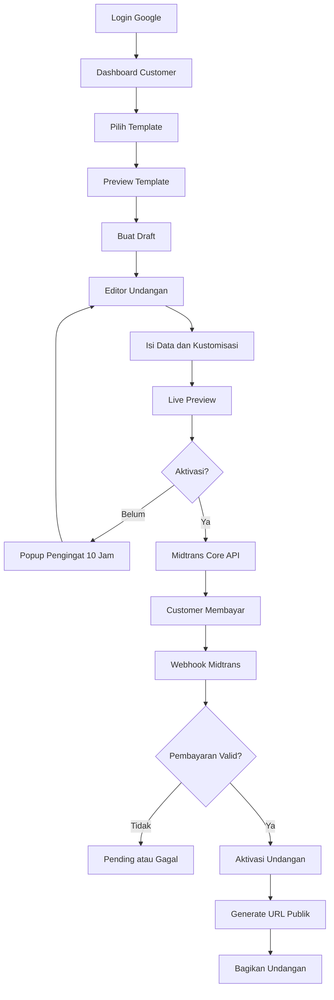

# PRODUCT REQUIREMENTS DOCUMENT (PRD)
# PLATFORM UNDANGAN DIGITAL

**Versi:** 1.0  
**Platform:** Web Application  
**Backend:** Laravel  
**Database:** MySQL  
**Payment Gateway:** Midtrans Core API  
**Authentication:** Google OAuth  
**User Roles:** Super Admin dan Customer

---

# 1. PROJECT OVERVIEW

## 1.1 Deskripsi Sistem

Aplikasi Undangan Digital merupakan platform berbasis web yang memungkinkan pengguna membuat undangan pernikahan digital secara mandiri dengan memilih template yang telah disediakan oleh administrator.

Pengguna dapat melihat preview template sebelum memilih, mengisi informasi pasangan, mengatur acara pernikahan, menambahkan galeri foto, memilih tema, menambahkan musik, serta mengatur berbagai elemen undangan melalui editor yang mudah digunakan.

Sistem menyediakan fitur Live Preview sehingga setiap perubahan yang dilakukan pengguna dapat langsung terlihat pada tampilan undangan.

Setelah pengguna membuat undangan, sistem memberikan masa preview selama 10 jam. Selama periode tersebut, pengguna dapat melakukan perubahan terhadap undangannya. Sistem akan menampilkan notifikasi atau popup pengingat untuk segera melakukan aktivasi melalui pembayaran.

Setelah pembayaran berhasil diverifikasi melalui Midtrans Core API, undangan akan diaktifkan dan dapat dibagikan kepada tamu melalui sebuah URL publik.

## 1.2 Tujuan Sistem

1. Memudahkan pengguna membuat undangan pernikahan digital.
2. Menyediakan template undangan siap pakai.
3. Memberikan pengalaman editing dengan live preview.
4. Mengintegrasikan pembayaran otomatis melalui Midtrans.
5. Menyediakan halaman undangan publik yang dapat dibagikan.
6. Memberikan administrator kendali penuh terhadap template, harga, pelanggan, dan transaksi.

## 1.3 Teknologi

| Komponen | Teknologi |
|---|---|
| Backend | Laravel |
| Frontend | Blade + JavaScript |
| Styling | Tailwind CSS / CSS |
| Database | MySQL |
| Authentication | Google OAuth |
| Payment Gateway | Midtrans Core API |
| Template | HTML, CSS, JavaScript |
| Storage | Local Storage / Laravel Storage |
| Web Server | Apache / Nginx |

---

# 2. ROLE DAN HAK AKSES

Sistem hanya memiliki dua role utama.

## 2.1 Super Admin

Super Admin memiliki akses penuh terhadap seluruh sistem.

Hak akses:
- Mengakses dashboard administrator.
- Mengelola template undangan.
- Menambahkan template baru.
- Mengedit informasi template.
- Mengaktifkan dan menonaktifkan template.
- Mengatur harga pembuatan undangan.
- Melihat seluruh pelanggan.
- Melihat dan mengelola transaksi.
- Memeriksa status pembayaran.
- Mengelola undangan pelanggan.
- Mengaktifkan atau menonaktifkan undangan secara manual.
- Mengelola pengaturan website.
- Melihat statistik penggunaan aplikasi.

## 2.2 Customer

Customer merupakan pengguna yang membuat undangan digital.

Hak akses:
- Login menggunakan akun Google.
- Melihat daftar template.
- Melihat preview template.
- Memilih template.
- Membuat undangan baru.
- Mengisi informasi pasangan.
- Mengatur informasi acara.
- Menambahkan galeri foto.
- Memilih musik.
- Memilih tema undangan.
- Mengedit konten undangan.
- Melihat live preview.
- Menyimpan perubahan.
- Melakukan pembayaran.
- Melihat status aktivasi.
- Membagikan link undangan.
- Mengelola undangan miliknya.

Customer tidak boleh mengakses data atau undangan milik pengguna lain.

---

# 3. AUTHENTICATION DAN LOGIN

## 3.1 Login Google

Sistem menggunakan Google OAuth agar pengguna dapat langsung masuk tanpa membuat password secara manual.

Alur:
1. Pengguna membuka website.
2. Pengguna menekan tombol Login dengan Google.
3. Sistem mengarahkan pengguna ke halaman autentikasi Google.
4. Pengguna memilih akun Google.
5. Google mengirimkan informasi autentikasi ke aplikasi.
6. Laravel memverifikasi autentikasi.
7. Sistem membuat akun customer secara otomatis apabila belum terdaftar.
8. Pengguna diarahkan ke dashboard customer.

Data yang disimpan:
- Nama pengguna.
- Email.
- Google ID.
- Foto profil.
- Tanggal registrasi.
- Status akun.

Ketentuan:
- Tidak menyediakan registrasi menggunakan password.
- Tidak menyediakan login manual menggunakan email dan password.
- Satu akun Google terhubung dengan satu akun customer.
- Super Admin ditentukan melalui pengaturan administrator, bukan melalui pilihan role pada halaman login.
- Customer tidak boleh mengubah rolenya sendiri.

---

# 4. TEMPLATE UNDANGAN DIGITAL

## 4.1 Integrasi Template Existing

Aplikasi sudah memiliki dua template undangan berbentuk HTML yang berada di folder `template`.

Kedua template tersebut harus dijadikan template awal aplikasi.

Developer wajib:
1. Memeriksa seluruh isi folder `template`.
2. Mengidentifikasi struktur HTML, CSS, JavaScript, gambar, font, dan aset lainnya.
3. Memahami struktur setiap template.
4. Mengidentifikasi bagian yang dapat diedit secara dinamis.
5. Mengintegrasikan template ke sistem Laravel.
6. Mempertahankan desain asli template semaksimal mungkin.

Jangan membuat ulang desain kedua template apabila desain aslinya sudah tersedia dan berfungsi.

Template harus dibuat menggunakan sistem data dinamis sehingga satu template dapat digunakan oleh banyak customer dengan konten berbeda.

## 4.2 Halaman Daftar Template

Customer dapat melihat semua template yang tersedia.

Informasi setiap template:
- Thumbnail template.
- Nama template.
- Deskripsi.
- Kategori atau gaya desain.
- Harga.
- Status ketersediaan.
- Tombol Preview.
- Tombol Gunakan Template.

## 4.3 Preview Template

Sebelum memilih template, customer dapat melihat contoh undangan secara utuh.

Fitur:
- Preview tampilan undangan.
- Tampilan responsif.
- Preview pada perangkat desktop dan mobile.
- Navigasi antarbagian undangan.
- Tombol kembali ke daftar template.

Preview template harus menggunakan data contoh, bukan data customer.

## 4.4 Pengelolaan Template oleh Super Admin

Super Admin dapat:
- Menambahkan template.
- Mengunggah atau mengelola file template HTML.
- Mengatur thumbnail.
- Mengatur nama template.
- Mengatur deskripsi.
- Mengatur harga.
- Mengatur kategori.
- Mengaktifkan template.
- Menonaktifkan template.

Template yang sudah digunakan customer tidak boleh rusak ketika administrator memperbarui template.

Sistem harus mempertahankan versi template atau salinan struktur template yang digunakan pada undangan yang sudah dibuat.

---

# 5. EDITOR UNDANGAN DIGITAL

## 5.1 Konsep Editor

Editor merupakan fitur utama aplikasi.

Customer dapat mengisi dan mengubah seluruh informasi undangan melalui dashboard editor.

Layout editor:
- Panel sebelah kiri: menu pengaturan dan form editing.
- Panel sebelah kanan: live preview undangan.
- Bagian atas: tombol simpan, preview, dan aktivasi.

Live preview harus memperlihatkan perubahan secara langsung tanpa harus melakukan reload halaman.

Pada perangkat mobile, editor dapat menggunakan tab atau tombol untuk berpindah antara panel pengaturan dan preview.

## 5.2 Informasi Pasangan

Customer dapat mengisi informasi kedua calon mempelai.

**Data mempelai pria:**
- Nama lengkap.
- Nama panggilan.
- Foto.
- Nama ayah.
- Nama ibu.
- Link Instagram.
- Link media sosial lainnya (opsional).

**Data mempelai wanita:**
- Nama lengkap.
- Nama panggilan.
- Foto.
- Nama ayah.
- Nama ibu.
- Link Instagram.
- Link media sosial lainnya (opsional).

Fitur:
- Upload foto.
- Preview foto.
- Mengganti foto.
- Menghapus foto.
- Validasi format dan ukuran file.

## 5.3 Informasi Acara

Customer dapat menambahkan informasi acara pernikahan.

Jenis acara:
- Akad Nikah.
- Resepsi.
- Acara tambahan (opsional).

Data acara:
- Nama acara.
- Tanggal acara.
- Jam mulai.
- Jam selesai.
- Zona waktu.
- Lokasi acara.
- Alamat lengkap.
- Link Google Maps.
- Keterangan tambahan.

Sistem harus mendukung lebih dari satu acara dalam satu undangan.

Fitur tambahan:
- Countdown menuju hari pernikahan.
- Tombol navigasi Google Maps.
- Tombol salin alamat.
- Informasi tanggal dan waktu acara.

## 5.4 Cerita Pasangan (Opsional)

Customer dapat menambahkan cerita perjalanan pasangan.

Informasi:
- Judul cerita.
- Deskripsi cerita.
- Tanggal atau tahun.
- Foto pendukung.
- Urutan cerita.

Customer dapat menambahkan beberapa bagian cerita.

Apabila tidak diisi, bagian cerita tidak ditampilkan pada undangan publik.

## 5.5 Turut Mengundang (Opsional)

Customer dapat mengisi daftar keluarga atau pihak yang turut mengundang.

Fitur:
- Tambah nama.
- Edit nama.
- Hapus nama.
- Mengatur urutan.
- Menampilkan atau menyembunyikan bagian turut mengundang.

Jika kosong, bagian tersebut tidak ditampilkan.

---

# 6. PENGATURAN TEMA UNDANGAN

Customer dapat menyesuaikan tampilan undangan sesuai preferensi.

Fitur:
- Memilih kombinasi warna.
- Memilih tema desain yang disediakan.
- Mengubah warna utama.
- Mengubah warna sekunder jika template mendukung.
- Memilih jenis font yang tersedia.
- Mengatur tampilan dekorasi sesuai opsi template.

Pilihan tema harus mengikuti kemampuan masing-masing template.

Perubahan tema langsung terlihat pada live preview.

---

# 7. GALERI FOTO

Customer dapat menambahkan foto pasangan ke dalam galeri undangan.

Fitur:
- Upload beberapa foto.
- Preview foto.
- Menghapus foto.
- Mengganti foto.
- Mengatur urutan foto.
- Menentukan foto utama jika template mendukung.
- Mengatur jumlah foto yang ditampilkan.

Ketentuan:
- Mendukung format JPG, JPEG, PNG, dan WebP.
- Validasi ukuran file.
- Optimasi gambar sebelum ditampilkan.
- Menggunakan lazy loading.
- Foto hanya dapat dikelola pemilik undangan.

Apabila galeri tidak diisi, bagian galeri dapat disembunyikan secara otomatis.

---

# 8. MUSIK UNDANGAN

Customer dapat memilih musik latar untuk undangan digital.

Fitur:
- Daftar musik yang tersedia.
- Preview atau pemutaran musik.
- Memilih musik.
- Mengganti musik.
- Menonaktifkan musik.
- Mengatur perilaku tombol musik pada undangan.

Super Admin dapat:
- Menambahkan musik.
- Mengunggah file audio.
- Mengatur judul musik.
- Mengatur informasi artis.
- Mengaktifkan atau menonaktifkan musik.

Gunakan musik yang memiliki izin penggunaan atau lisensi yang sesuai.

Catatan: Pemutaran otomatis harus mengikuti kebijakan browser. Sistem menyediakan tombol untuk memulai atau menghentikan musik jika autoplay dibatasi oleh browser.

---

# 9. SISTEM PREVIEW DAN MASA 10 JAM

## 9.1 Masa Preview

Setelah customer memilih template dan mulai membuat undangan, sistem membuat draft undangan.

Draft tersebut memiliki masa preview selama 10 jam.

Selama masa tersebut customer dapat:
- Mengisi informasi pasangan.
- Mengubah informasi acara.
- Mengunggah foto.
- Mengubah tema.
- Mengatur galeri.
- Memilih musik.
- Mengubah cerita pasangan.
- Melihat preview.
- Menyimpan perubahan.

## 9.2 Perhitungan Waktu

Waktu 10 jam dihitung sejak draft undangan pertama kali dibuat.

Sistem menyimpan:
- Waktu pembuatan draft.
- Waktu mulai preview.
- Waktu berakhir preview.
- Status draft.
- Status pembayaran.

Perubahan konten tidak mereset waktu 10 jam.

## 9.3 Popup Pengingat Aktivasi

Selama periode preview, sistem menampilkan popup pengingat untuk melakukan aktivasi pembayaran.

Isi popup:

**Aktifkan Undangan Digital Anda!**

Undangan Anda sudah siap dipublikasikan. Segera lakukan aktivasi agar undangan dapat dibagikan kepada keluarga dan kerabat.

Tampilkan:
- Sisa waktu preview.
- Harga aktivasi.
- Tombol Aktifkan Sekarang.
- Tombol Nanti Saja atau tutup popup.

Popup harus:
- Bisa ditutup.
- Tidak menghalangi seluruh aktivitas editing secara permanen.
- Tidak muncul berulang kali secara berlebihan.
- Tetap menampilkan pengingat aktivasi pada dashboard.
- Menampilkan informasi sisa waktu.

## 9.4 Ketika Waktu Habis

Jika 10 jam telah berakhir dan belum ada pembayaran:

- Draft berubah menjadi status EXPIRED.
- Customer tidak dapat melanjutkan proses editing melalui sesi preview.
- Preview sementara dinonaktifkan.
- Customer diarahkan untuk melakukan aktivasi atau membuat draft baru sesuai kebijakan sistem.

Sistem harus menyediakan mekanisme pembersihan draft kedaluwarsa agar penyimpanan tidak menumpuk.

---

# 10. SISTEM PEMBAYARAN MIDTRANS CORE API

## 10.1 Integrasi Pembayaran

Sistem menggunakan Midtrans Core API sebagai payment gateway.

Customer dapat melakukan pembayaran untuk mengaktifkan undangan digital.

Metode pembayaran mengikuti metode yang tersedia pada akun Midtrans, seperti:
- QRIS.
- Virtual Account.
- E-Wallet.
- Transfer bank.
- Metode lain yang diaktifkan pada akun Midtrans.

## 10.2 Alur Pembayaran

1. Customer menekan tombol Aktifkan Sekarang.
2. Sistem memeriksa status draft dan masa berlakunya.
3. Laravel membuat order ID unik.
4. Laravel mengirim permintaan transaksi ke Midtrans Core API.
5. Midtrans mengembalikan informasi pembayaran.
6. Sistem menampilkan instruksi pembayaran kepada customer.
7. Customer melakukan pembayaran.
8. Midtrans mengirim notifikasi melalui Payment Notification URL (Webhook).
9. Laravel memverifikasi notifikasi menggunakan Server Key dan mekanisme autentikasi Midtrans.
10. Sistem memperbarui status transaksi.
11. Jika pembayaran berhasil, status undangan berubah menjadi ACTIVE.
12. Sistem membuat atau mengaktifkan URL publik undangan.

## 10.3 Status Pembayaran

Sistem mendukung status:
- PENDING.
- PAID.
- SETTLEMENT.
- EXPIRE.
- CANCEL.
- DENY.
- REFUND.

Pemetaan status harus mengikuti status transaksi resmi Midtrans.

## 10.4 Ketentuan Keamanan Pembayaran

- Server Key hanya disimpan di file `.env`.
- Jangan pernah menampilkan Server Key kepada browser.
- Jangan mengandalkan redirect halaman sukses sebagai bukti pembayaran.
- Aktivasi hanya dilakukan setelah notifikasi pembayaran diverifikasi.
- Verifikasi menggunakan signature key atau mekanisme autentikasi resmi Midtrans.
- Webhook harus idempotent agar notifikasi berulang tidak menyebabkan aktivasi ganda.
- Simpan riwayat transaksi.
- Cocokkan order ID, nominal, dan status transaksi.
- Sediakan mekanisme pengecekan ulang status transaksi melalui API Midtrans.

## 10.5 Dashboard Transaksi Customer

Customer dapat melihat:
- ID transaksi.
- Nama undangan.
- Nominal pembayaran.
- Metode pembayaran.
- Tanggal transaksi.
- Status pembayaran.
- Tombol lanjutkan pembayaran jika masih pending.

---

# 11. PUBLIKASI DAN LINK UNDANGAN

## 11.1 Aktivasi Undangan

Setelah pembayaran berhasil, sistem mengaktifkan undangan.

Setiap undangan mempunyai URL unik.

Contoh:

`domain.com/undangan/anhar-dan-pasangan`

Slug harus unik dan dapat diatur atau diperbarui sesuai kebijakan sistem.

## 11.2 Tampilan Undangan Publik

Halaman undangan harus menggunakan template yang dipilih customer dan menampilkan data yang sudah diisi.

Fitur standar:
- Cover undangan.
- Nama pasangan.
- Foto pasangan.
- Informasi acara.
- Countdown.
- Google Maps.
- Cerita pasangan jika tersedia.
- Galeri foto.
- Musik.
- Turut mengundang jika tersedia.
- Tombol buka undangan.
- Tombol bagikan undangan.

Tampilan wajib responsif pada smartphone, tablet, dan desktop.

## 11.3 Fitur Bagikan Undangan

Customer dapat membagikan undangan melalui:
- WhatsApp.
- Facebook.
- Telegram.
- Salin link.

Sistem juga harus mendukung personalisasi nama tamu.

Contoh:

`domain.com/undangan/anhar-dan-pasangan?to=Nama+Tamu`

Nama tamu ditampilkan pada cover undangan apabila template mendukung fitur tersebut.

## 11.4 Fitur Tambahan Undangan

Sediakan fitur standar yang dapat didukung template:
- Ucapan dan doa dari tamu.
- RSVP atau konfirmasi kehadiran.
- Amplop digital (opsional).
- Buku tamu.
- Tombol navigasi lokasi.

Fitur tambahan dapat dikembangkan secara bertahap dan tidak boleh menghambat implementasi fitur inti.

---

# 12. DASHBOARD CUSTOMER

Dashboard customer menampilkan seluruh undangan miliknya.

## 12.1 Halaman Dashboard

Informasi:
- Jumlah undangan.
- Undangan aktif.
- Undangan draft.
- Undangan kedaluwarsa.
- Transaksi terakhir.

## 12.2 Daftar Undangan Saya

Setiap undangan menampilkan:
- Thumbnail template.
- Nama pasangan.
- Tanggal acara.
- Status undangan.
- Status pembayaran.
- Sisa waktu preview jika masih draft.

Aksi:
- Edit undangan.
- Preview.
- Aktifkan.
- Bagikan.
- Lihat undangan.
- Hapus draft.

## 12.3 Status Undangan

Status yang digunakan:
- DRAFT.
- PREVIEW.
- EXPIRED.
- PENDING_PAYMENT.
- ACTIVE.
- SUSPENDED.

Status pembayaran dan status publikasi undangan harus dikelola secara terpisah agar tidak terjadi konflik logika.

---

# 13. DASHBOARD SUPER ADMIN

## 13.1 Dashboard

Menampilkan:
- Total customer.
- Total undangan.
- Total undangan aktif.
- Total draft.
- Total transaksi.
- Total pendapatan.
- Transaksi pending.
- Template tersedia.

## 13.2 Manajemen Customer

Super Admin dapat:
- Melihat daftar customer.
- Melihat detail customer.
- Melihat undangan customer.
- Melihat riwayat pembayaran.
- Menonaktifkan akun customer jika diperlukan.

## 13.3 Manajemen Undangan

Super Admin dapat:
- Melihat semua undangan.
- Memeriksa detail undangan.
- Melihat status aktivasi.
- Melihat status pembayaran.
- Menonaktifkan undangan.
- Mengaktifkan undangan secara manual dengan pencatatan alasan dan aktivitas administrator.

## 13.4 Manajemen Template

Super Admin dapat mengelola:
- File template.
- Thumbnail.
- Nama template.
- Deskripsi.
- Harga.
- Kategori.
- Status template.
- Versi template.

## 13.5 Manajemen Musik

Super Admin dapat mengelola koleksi musik yang tersedia untuk customer.

## 13.6 Manajemen Pengaturan

Pengaturan:
- Nama aplikasi.
- Logo.
- Favicon.
- Harga aktivasi.
- Durasi preview.
- Pengaturan Midtrans.
- Informasi kontak.
- Pengaturan SEO.
- Pengaturan URL publik.

---

# 14. STRUKTUR DATABASE

Database menggunakan MySQL dengan relasi yang terstruktur.

Tabel utama yang direkomendasikan:

### 1. users
- id
- google_id
- name
- email
- avatar
- role
- status
- timestamps

### 2. templates
- id
- name
- slug
- description
- thumbnail
- template_path
- price
- version
- status
- timestamps

### 3. invitations
- id
- user_id
- template_id
- title
- slug
- status
- preview_started_at
- preview_expires_at
- activated_at
- published_at
- timestamps

### 4. invitation_grooms
- id
- invitation_id
- full_name
- nickname
- photo
- father_name
- mother_name
- instagram
- social_links

### 5. invitation_brides
- id
- invitation_id
- full_name
- nickname
- photo
- father_name
- mother_name
- instagram
- social_links

### 6. invitation_events
- id
- invitation_id
- event_type
- title
- event_date
- start_time
- end_time
- timezone
- location_name
- address
- maps_url
- description

### 7. invitation_stories
- id
- invitation_id
- title
- description
- story_date
- image
- sort_order

### 8. invitation_families
- id
- invitation_id
- name
- sort_order

### 9. invitation_galleries
- id
- invitation_id
- image
- sort_order

### 10. invitation_settings
- id
- invitation_id
- theme
- primary_color
- secondary_color
- font_family
- music_id
- custom_settings

### 11. musics
- id
- title
- artist
- file_path
- status

### 12. transactions
- id
- user_id
- invitation_id
- order_id
- gross_amount
- payment_method
- transaction_status
- payment_type
- transaction_time
- paid_at
- midtrans_response
- timestamps

### 13. invitation_guests
- id
- invitation_id
- guest_name
- attendance_status
- guest_count
- message

### 14. invitation_greetings
- id
- invitation_id
- guest_name
- message
- status

### 15. settings
- id
- key
- value

### 16. activity_logs
- id
- user_id
- action
- description
- timestamps

Relasi harus menggunakan foreign key, indeks yang sesuai, serta aturan penghapusan data yang aman.

Struktur dapat disesuaikan selama seluruh kebutuhan sistem tetap terpenuhi.

---

# 15. ARSITEKTUR TEMPLATE

Template HTML existing harus diperlakukan sebagai komponen desain yang dapat menerima data dinamis.

Rekomendasi implementasi:

1. Pisahkan struktur desain setiap template.
2. Gunakan konfigurasi atau data JSON untuk menghubungkan data undangan dengan template.
3. Buat mekanisme render template menggunakan Blade atau komponen Laravel.
4. Gunakan sistem konfigurasi untuk bagian opsional.
5. Jangan menyimpan seluruh HTML hasil input customer secara langsung.
6. Batasi akses template berdasarkan kepemilikan dan status undangan.
7. Pertahankan versi template yang telah digunakan.

Setiap template harus memiliki konfigurasi fitur, misalnya:
- Mendukung cerita pasangan.
- Mendukung galeri.
- Mendukung musik.
- Mendukung tema warna.
- Mendukung RSVP.
- Mendukung turut mengundang.

Dengan demikian, editor dapat menampilkan menu yang relevan berdasarkan kemampuan template yang dipilih.

---

# 16. ALUR UTAMA SISTEM

## 16.1 Alur Customer

1. Customer membuka website.
2. Login menggunakan Google.
3. Masuk ke dashboard.
4. Memilih menu Buat Undangan.
5. Melihat daftar template.
6. Melihat preview template.
7. Memilih template.
8. Sistem membuat draft undangan.
9. Masa preview 10 jam dimulai.
10. Customer masuk ke halaman editor.
11. Customer mengisi data pasangan.
12. Customer mengisi informasi acara.
13. Customer menambahkan cerita jika diperlukan.
14. Customer mengatur tema.
15. Customer mengunggah galeri foto.
16. Customer memilih musik.
17. Customer melihat live preview.
18. Sistem menampilkan popup pengingat aktivasi.
19. Customer menekan Aktifkan Sekarang.
20. Customer melakukan pembayaran melalui Midtrans.
21. Sistem menerima dan memverifikasi notifikasi pembayaran.
22. Undangan otomatis aktif.
23. Sistem menghasilkan URL publik.
24. Customer membagikan undangan kepada tamu.

## 16.2 Diagram Alur

---

# 17. UI/UX DESIGN REQUIREMENTS

## 17.1 Desain Website

Gunakan desain modern, elegan, minimalis, dan responsif.

Karakteristik:
- Tampilan profesional.
- Dominasi warna netral.
- Aksen warna elegan.
- Navigasi sederhana.
- Animasi halus.
- Loading state yang informatif.
- Komponen konsisten.

## 17.2 Halaman Publik

Halaman:
- Homepage.
- Daftar template.
- Detail dan preview template.
- Login Google.
- Halaman bantuan atau informasi.

## 17.3 Editor

Editor harus mengutamakan kemudahan penggunaan.

Desktop:
- Sidebar editor.
- Preview undangan di sebelah kanan.
- Toolbar di bagian atas.

Mobile:
- Form editor menggunakan tab.
- Tombol preview yang mudah dijangkau.
- Preview memenuhi layar ketika dibuka.

---

# 18. SECURITY REQUIREMENTS

Sistem harus menerapkan:

1. Laravel Authentication.
2. Google OAuth verification.
3. Middleware berdasarkan role.
4. CSRF protection.
5. Validasi seluruh input.
6. Validasi upload file.
7. Proteksi terhadap SQL Injection.
8. Proteksi terhadap XSS.
9. Pembatasan akses berdasarkan kepemilikan undangan.
10. Proteksi endpoint webhook Midtrans.
11. Penyimpanan credential pada environment variables.
12. Validasi slug undangan.
13. Rate limiting.
14. Logging aktivitas penting.
15. Backup database berkala.

---

# 19. NON-FUNCTIONAL REQUIREMENTS

### Performance
- Halaman undangan harus cepat dibuka.
- Optimasi gambar.
- Lazy loading galeri.
- Minimalkan penggunaan JavaScript yang tidak diperlukan.
- Gunakan caching untuk data yang sesuai.
- Hindari query database berulang.

### Compatibility
- Google Chrome.
- Mozilla Firefox.
- Microsoft Edge.
- Safari.
- Browser Android dan iOS.

### Responsive
- Smartphone.
- Tablet.
- Desktop.

### Reliability
- Pembayaran harus diproses secara idempotent.
- Data draft harus tersimpan secara aman.
- Perubahan editor tidak boleh hilang akibat reload.
- Status pembayaran harus dapat diperiksa kembali.

---

# 20. TAHAPAN PENGEMBANGAN

## Tahap 1 — Analisis dan Persiapan
- Audit struktur project Laravel.
- Audit folder template.
- Identifikasi dua template HTML.
- Analisis aset dan dependensi.
- Rancang struktur database.

## Tahap 2 — Authentication dan Role
- Integrasi Google OAuth.
- Implementasi Super Admin.
- Implementasi Customer.
- Middleware dan hak akses.

## Tahap 3 — Template Management
- Daftar template.
- Preview template.
- Pemilihan template.
- Manajemen template admin.
- Integrasi template HTML dinamis.

## Tahap 4 — Invitation Editor
- Form data pasangan.
- Form acara.
- Cerita pasangan.
- Turut mengundang.
- Tema.
- Galeri.
- Musik.
- Live preview.
- Penyimpanan draft.

## Tahap 5 — Preview dan Pembayaran
- Timer 10 jam.
- Popup pengingat.
- Integrasi Midtrans Core API.
- Webhook.
- Verifikasi pembayaran.
- Aktivasi undangan.

## Tahap 6 — Publikasi
- URL undangan.
- Halaman publik.
- Share WhatsApp.
- Personalisasi nama tamu.
- Fitur RSVP dan ucapan.

## Tahap 7 — Dashboard dan Pengujian
- Dashboard customer.
- Dashboard admin.
- Statistik.
- Pengujian keamanan.
- Pengujian pembayaran.
- Pengujian responsivitas.
- Pengujian seluruh alur.

---

# 21. ACCEPTANCE CRITERIA

Pengembangan dinyatakan berhasil apabila:

1. Customer dapat login menggunakan Google.
2. Role hanya terdiri dari Super Admin dan Customer.
3. Kedua template HTML existing berhasil diintegrasikan.
4. Customer dapat melihat preview template.
5. Customer dapat memilih template.
6. Customer dapat mengedit informasi pasangan.
7. Customer dapat mengedit informasi acara.
8. Customer dapat menambahkan cerita pasangan secara opsional.
9. Customer dapat menambahkan turut mengundang secara opsional.
10. Customer dapat mengatur tema.
11. Customer dapat mengelola galeri foto.
12. Customer dapat memilih musik.
13. Live preview bekerja dengan baik.
14. Draft memiliki masa preview 10 jam.
15. Popup pengingat aktivasi dapat ditutup.
16. Customer dapat melakukan pembayaran.
17. Midtrans webhook dapat memverifikasi pembayaran.
18. Undangan otomatis aktif setelah pembayaran berhasil.
19. Setiap undangan memiliki URL publik unik.
20. Undangan dapat dibagikan melalui WhatsApp.
21. Customer tidak dapat mengakses undangan pengguna lain.
22. Super Admin dapat mengelola template, customer, dan transaksi.

---

# 22. INSTRUKSI KHUSUS UNTUK AI DEVELOPER AGENT

Implementasikan sistem berdasarkan PRD ini dengan memperhatikan kondisi project dan template yang sudah tersedia.

**PENTING:**

1. Jangan membangun ulang desain template dari nol.
2. Periksa folder `template` terlebih dahulu dan analisis kedua file HTML yang tersedia.
3. Pertahankan desain, animasi, font, layout, dan aset asli template.
4. Jadikan kedua template tersebut sebagai template awal yang dapat digunakan customer.
5. Jangan membuat editor yang hanya mengubah data tetapi tidak memperbarui tampilan undangan.
6. Pastikan live preview benar-benar bekerja.
7. Pastikan setiap template dapat menggunakan data customer secara dinamis.
8. Pisahkan data undangan setiap customer.
9. Implementasikan sistem masa preview 10 jam menggunakan waktu server.
10. Implementasikan Midtrans Core API dengan webhook yang aman.
11. Jangan mengaktifkan undangan hanya berdasarkan halaman redirect pembayaran.
12. Gunakan migration, model, controller, service, middleware, dan route Laravel secara terstruktur.
13. Jangan menumpuk seluruh logika dalam satu controller.
14. Pastikan aplikasi dapat berjalan pada shared hosting maupun VPS.
15. Gunakan konfigurasi environment untuk seluruh credential.
16. Jangan menghilangkan atau merusak fitur existing.
17. Lakukan testing setiap modul sebelum melanjutkan ke modul berikutnya.

**PRIORITAS UTAMA:** Sistem pemilihan template, editor undangan dengan live preview, masa preview 10 jam, pembayaran Midtrans, dan publikasi undangan harus berfungsi secara utuh sebelum mengembangkan fitur tambahan.

**HASIL AKHIR:** Aplikasi undangan digital siap digunakan, dengan dua template HTML existing sebagai template awal dan sistem yang memungkinkan Super Admin menambahkan template baru tanpa harus membangun ulang keseluruhan aplikasi.